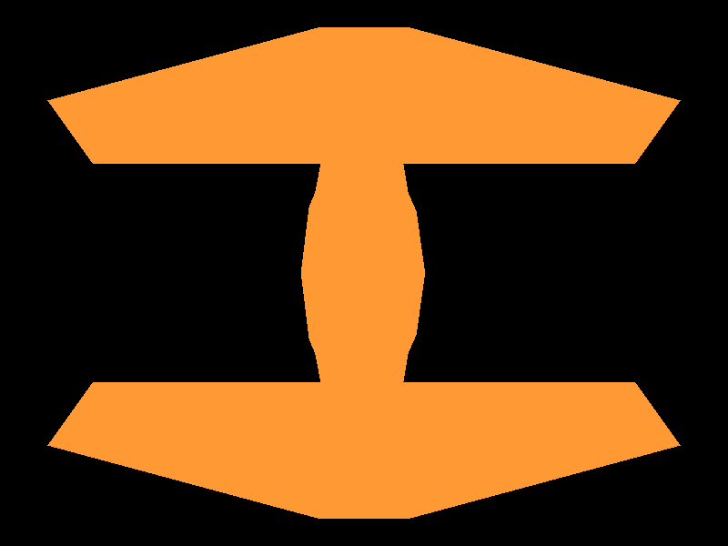
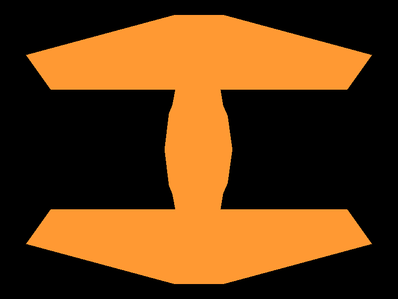
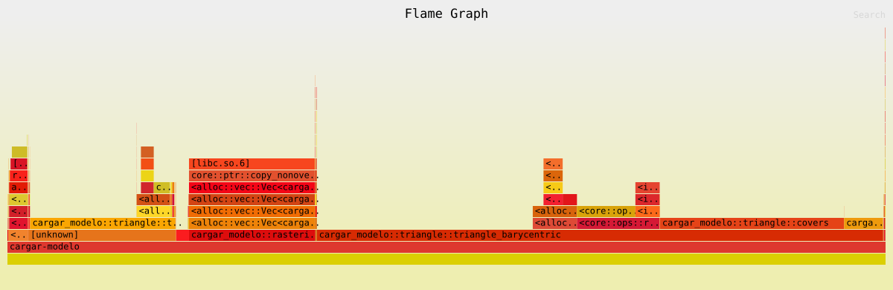

# Pipeline de gráficas y relleno de triángulos

Renderer en Rust que carga un modelo `.obj` y lo dibuja pasando por un pipeline
propio: vértices → triángulos → fragmentos → framebuffer. Raylib se usa solo
para su `Image` (el buffer de píxeles), para exportarla a PNG y para mostrarla
en una ventana; no se usa ninguna función de Raylib para cargar o dibujar
modelos 3D.

| Wireframe | Baricéntrico | Scanline |
|---|---|---|
|  |  |  |

## Estructura

- `src/main.rs`: `render` con las cuatro etapas, `Uniforms`, la matriz de modelo
  y el modo `--benchmark-triangles`.
- `src/vertex.rs`: `Vertex` con `position`, `color` y `transformed_position`.
- `src/fragment.rs`: `Fragment` con posición, color y profundidad.
- `src/shaders.rs`: `vertex_shader` (multiplica la posición por la matriz de
  modelo) y `fragment_shader` (passthrough, devuelve el color del fragmento).
- `src/primitive.rs`: `primitive_assembly`, agrupa los vértices de tres en tres.
- `src/rasterizer.rs`: `TriangleMode` y `rasterize`, que llama al algoritmo del
  modo elegido para cada triángulo.
- `src/triangle.rs`: los tres algoritmos (`triangle`, `triangle_barycentric`,
  `triangle_scanline`) y sus pruebas.
- `src/line.rs`: Bresenham, ahora devuelve fragmentos en vez de escribir en el
  framebuffer.
- `src/framebuffer.rs`: `point(x, y, color)` escribe un color en la imagen.
- `src/obj.rs`: cargador de OBJ.

## El pipeline

```rust
// 1. Procesamiento de vértices
let transformed_vertices = vertex_array.iter().map(|v| vertex_shader(v, uniforms)).collect();
// 2. Ensamblaje de primitivas
let triangles = primitive_assembly(&transformed_vertices);
// 3. Rasterización
let fragments = rasterize(&triangles, uniforms.triangle_mode);
// 4. Procesamiento de fragmentos
for fragment in fragments {
    let color = fragment_shader(&fragment);
    framebuffer.point(fragment.position.x as i32, fragment.position.y as i32, color);
}
```

Antes el centrado y el escalado del modelo se hacían a mano en `main`. Ahora
todo eso está en la matriz de modelo: una rotación de 90° en x (Blender es Z-up,
así que la altura del modelo pasa a ser el eje y de la pantalla, que crece hacia
abajo), una escala para que ocupe el 90 % de la ventana y una traslación para
centrarlo. El wireframe que sale del pipeline es idéntico píxel por píxel a la
imagen que generaba la versión anterior.

El modo de dibujo lo guardé en `Uniforms`, ya que es un dato que comparten todos
los triángulos del mismo dibujo y así `render` mantiene la firma que pedía la
lección.

## Los dos rellenos

**Baricéntrico.** Calcula el rectángulo más pequeño que contiene al triángulo y
para cada píxel evalúa su centro `(x + 0.5, y + 0.5)` con las tres funciones de
arista. Esas tres funciones divididas entre el área son las coordenadas
baricéntricas, y con ellas se interpola la profundidad. Si el área es negativa
(vértices en orden inverso) intercambio dos vértices para que el signo sea
siempre el mismo, y si el área es cero el triángulo es degenerado y no genera
nada.

**Scanline.** Ordena los vértices por y y recorre una fila a la vez. En cada
fila calcula dónde la cruzan la arista larga (del vértice de arriba al de
abajo) y la arista corta que toque, y genera fragmentos entre esos dos cruces.

Los dos usan la misma regla para decidir qué píxeles entran, la regla
*top-left*: un píxel entra si su centro está dentro del triángulo, o si cae
justo sobre una arista izquierda o superior. Si cae sobre una arista derecha o
inferior no entra. En scanline esto se traduce a tomar las filas cuyo centro
está en `[y_min, y_max)` y las columnas en `[x_izq, x_der)`. Con esta regla dos
triángulos que comparten una arista nunca dibujan el mismo píxel y tampoco
queda un hueco entre ellos, por eso las aristas horizontales y los vértices
que caen justo en una fila no dan problemas.

## Pruebas

`cargo test` corre los casos que pedía el laboratorio con los dos algoritmos y
compara las posiciones que generan, no solo cómo se ven:

- un triángulo pequeño y uno grande,
- uno con borde horizontal arriba, otro con borde horizontal abajo y otro con
  borde vertical,
- los mismos vértices en orden inverso,
- uno que se sale del framebuffer,
- tres vértices sobre una misma línea (no genera fragmentos),
- un cuadrado partido en dos triángulos, que tiene que cubrir cada píxel
  exactamente una vez.

También están las pruebas del ensamblaje: seis vértices dan dos triángulos en
orden, y con siete el programa se detiene con el mensaje "La cantidad de
vértices debe ser múltiplo de 3", porque si no, el último vértice se perdería
sin que nadie se diera cuenta.

## Mediciones

```
cargo run --release -- --benchmark-triangles
```

Se mide solo `rasterize` (la generación de fragmentos, incluyendo crear y
guardar el `Vec`), sin la textura, la ventana ni el framebuffer. Cada medición
son 100 ejecuciones sobre los 140 triángulos del modelo y se toma la mediana de
9 mediciones.

| Modo | Fragmentos | Mediana (100 ejecuciones) | Por ejecución |
|---|---:|---:|---:|
| Wireframe | 41 600 | 22.8 ms | 0.23 ms |
| Baricéntrico | 602 856 | 666.9 ms | 6.67 ms |
| Scanline | 602 854 | 224.1 ms | 2.24 ms |

Scanline es como tres veces más rápido que el baricéntrico generando
prácticamente los mismos fragmentos. Tiene sentido, ya que el baricéntrico
revisa todos los píxeles del rectángulo que rodea al triángulo y calcula tres
funciones de arista para cada uno, aunque muchos queden fuera (y en este modelo
hay varios triángulos largos y delgados, donde casi todo el rectángulo está
vacío). Scanline, en cambio, solo hace dos divisiones por fila y después
recorre directo los píxeles que sí están adentro.

### La diferencia de 2 fragmentos

Los dos algoritmos difieren solo en el píxel (703, 501), que aparece dos veces
porque el modelo tiene dos triángulos encimados en esa zona (la cara de
adelante y la de atrás). El centro de ese píxel, `(703.5, 501.5)`, cae
exactamente sobre una arista derecha. Scanline calcula que la arista cruza la
fila en `x = 703.500000`, así que lo deja fuera como dice la regla. El
baricéntrico tendría que obtener 0 en la función de arista, pero por el
redondeo de `f32` le da `+0.0024`, lo toma como si estuviera adentro y genera el
fragmento. Por lo tanto la regla es la misma en los dos, la diferencia viene de
que cada uno hace cuentas distintas y el error de redondeo cae de distinto lado.

## Perfil

```
CARGO_PROFILE_RELEASE_DEBUG=true cargo flamegraph -- --benchmark-triangles
```

`CARGO_PROFILE_RELEASE_DEBUG=true` deja los símbolos de depuración en el build
optimizado, así el flamegraph muestra los nombres de las funciones (incluso las
que el compilador metió inline). El perfil cubre la corrida completa del
benchmark, o sea los tres modos juntos.

[](flamegraph.svg)

(Al abrir `flamegraph.svg` en el navegador se puede hacer clic en los bloques y
buscar funciones.)

Lo que ocupa cada parte del total de muestras:

| Función | % de muestras |
|---|---:|
| `triangle_barycentric` | 64.5 % |
| ↳ `covers` (la prueba de cada arista) | 21.0 % |
| ↳ `Vec::push` | 5.0 % |
| ↳ `edge` | 4.4 % |
| `triangle_scanline` | 16.6 % |
| ↳ `Vec::push` | 3.8 % |
| `Vec::extend` dentro de `rasterize` (copiar fragmentos) | 14.4 % |
| Crecimiento del `Vec` (`realloc`) | 2.1 % |
| `line` (wireframe) | 1.5 % |

En el baricéntrico casi todo el tiempo se va en los cálculos geométricos: las
funciones de arista y `covers`, que se evalúan para todos los píxeles del
rectángulo, estén adentro o no. Crear los fragmentos (`push`) es una parte
pequeña. En scanline pasa lo contrario, la geometría casi no aparece
(`cross_at` es el 0.1 %) porque solo se calcula dos veces por fila, y lo que
pesa es el ciclo que recorre los píxeles y guarda los fragmentos.

Lo que más me sorprendió es `extend`: el 14 % del tiempo se va en copiar los
fragmentos del `Vec` de cada triángulo al `Vec` total en `rasterize`, y otro 2 %
en hacer crecer ese `Vec`. Eso no tiene nada que ver con el algoritmo de
relleno, es solo mover memoria. Se podría quitar si cada función de triángulo
escribiera directo en un solo `Vec` que se le pase por referencia, pero lo dejé
así para respetar la estructura de la lección, donde `triangle` devuelve su
propio `Vec<Fragment>`.

## Ejecutar

Requiere Rust y `cmake` (para compilar Raylib).

```
cargo run --release
```

Genera `out_wireframe.png`, `out_barycentric.png` y `out_scanline.png`, y abre
una ventana donde las teclas 1, 2 y 3 cambian entre wireframe, baricéntrico y
scanline.
