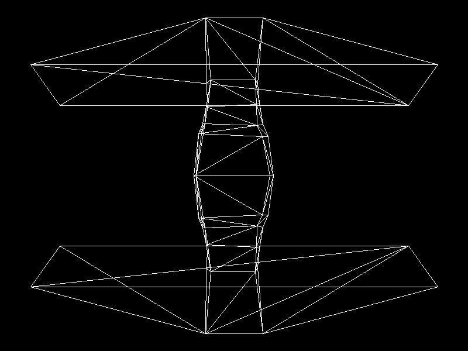

# Proyecto 1 — Parte 1: Dibujando un modelo OBJ

Renderer en Rust que carga un modelo `.obj` y dibuja todos sus triángulos
(solo contornos) con funciones propias. Raylib se usa únicamente para su
`Image` (el buffer de píxeles) y para exportarla a PNG; no se usa ninguna
función de Raylib para cargar o dibujar modelos 3D.



## Estructura

- `src/framebuffer.rs` — `Framebuffer`: buffer de píxeles, color actual, `set_pixel` y `render_to_file`.
- `src/line.rs` — `line` (algoritmo de Bresenham).
- `src/triangle.rs` — `triangle` (tres llamadas a `line`).
- `src/obj.rs` — cargador de OBJ: lee vértices (`v`) e índices de caras (`f`).
  Las caras con más de 3 vértices se dividen en triángulos.
- `src/main.rs` — carga `Untitled.obj`, convierte los vértices a coordenadas de
  pantalla (escala + traslación) y llama a `triangle` por cada cara.
- `Untitled.obj` — modelo exportado desde Blender (140 triángulos).

## Cómo se posiciona el modelo

Todavía no hay transformaciones 3D. Cada vértice se proyecta usando sus
componentes `x` y `z` (Blender es Z-up, así que `z` es la altura). Se calcula
el rectángulo que contiene al modelo y se escala (al 90 % de la imagen) y
traslada para que quede centrado y completamente visible. El eje Y se invierte
porque en pantalla crece hacia abajo.

## Ejecutar

Requiere Rust y `cmake` (para compilar Raylib).

```
cargo run
```

Genera `out.png` (800x600) con el modelo renderizado y lo muestra en una ventana hasta cerrarla.
